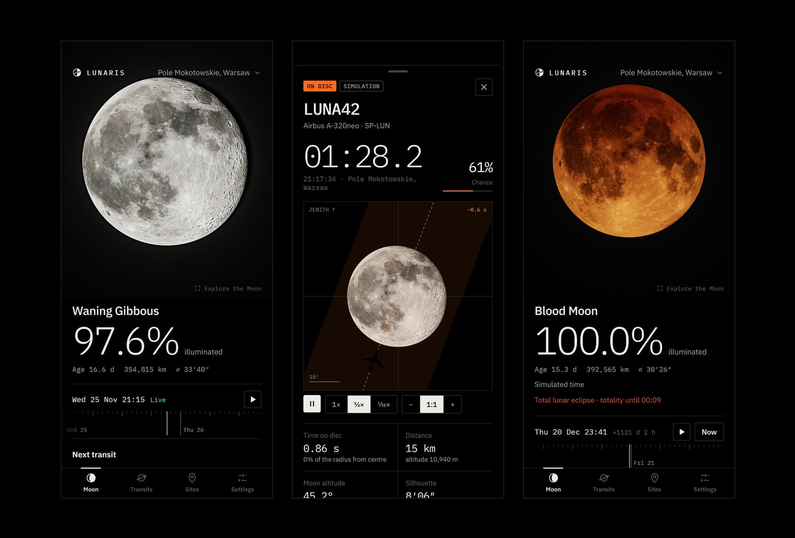
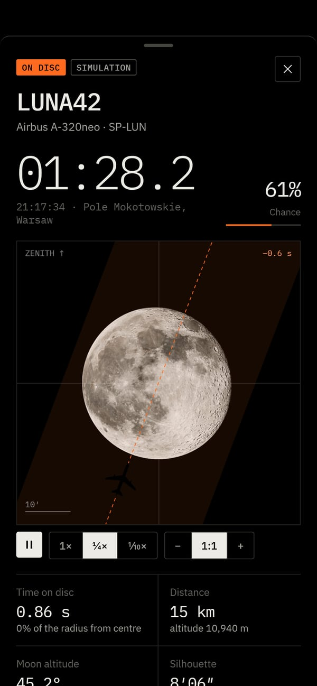
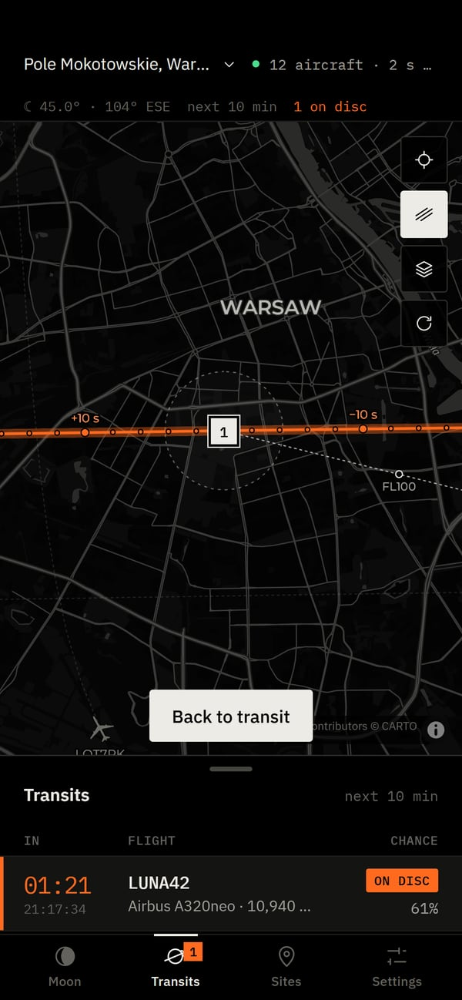
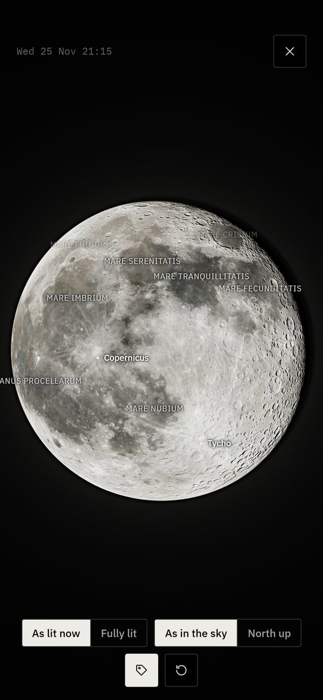
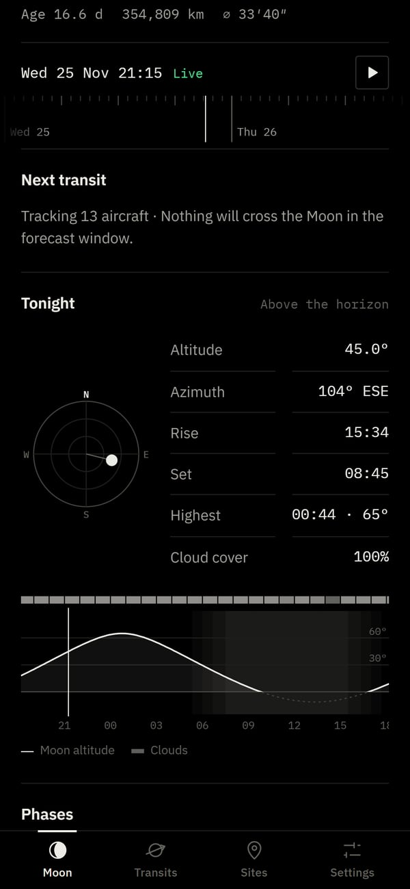
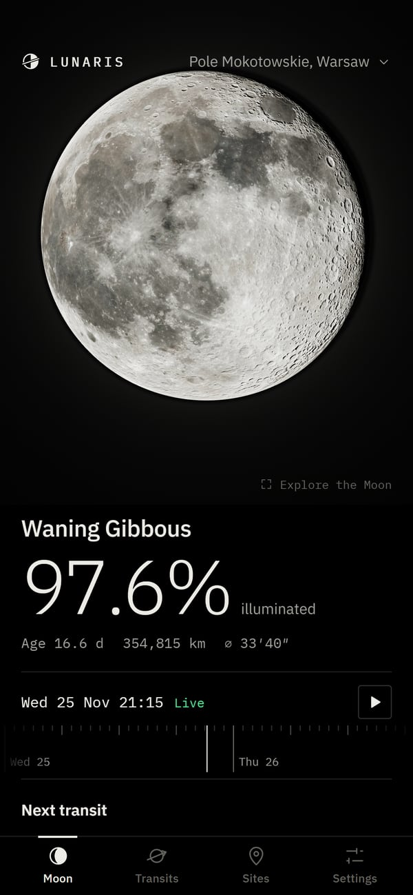
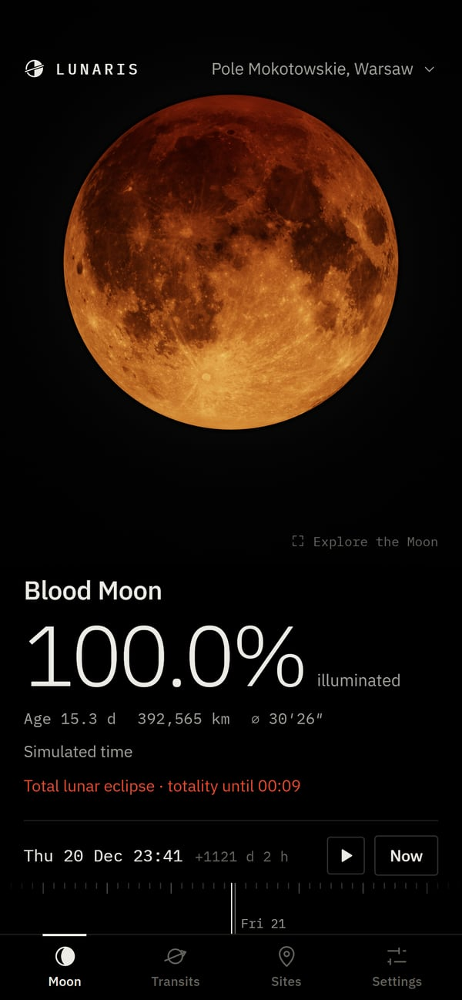
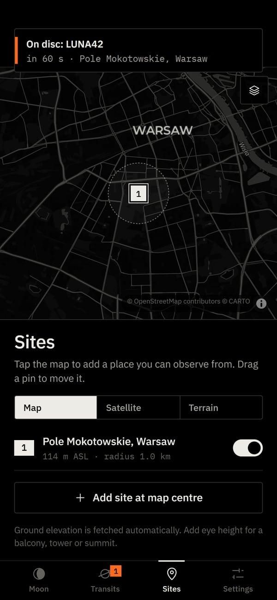
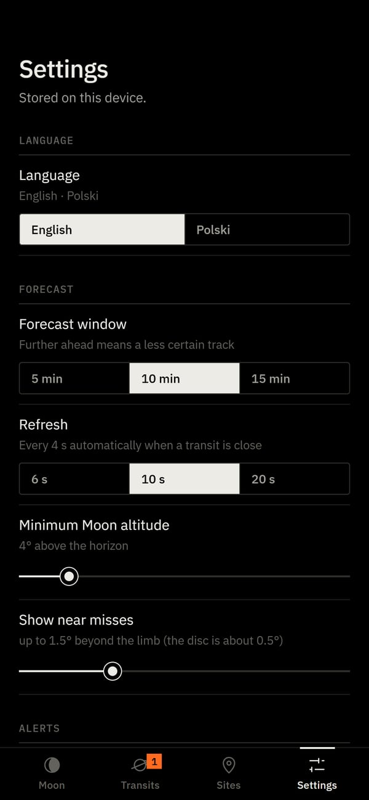
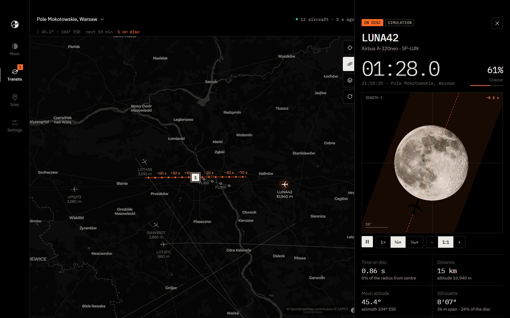

<p align="center">
  
</p>

<h1 align="center">Lunaris</h1>

<p align="center">
  <b>Catch an aircraft crossing the Moon.</b><br>
  Live ADS-B tracking that predicts, to a tenth of a second, when an aircraft will cross the Moon<br>
  above the places you can stand, and where to stand to see it dead centre.
</p>

<p align="center">
  <a href="https://github.com/szymoncim-sudo/lunaris/releases/latest"><b>Download for Windows</b></a>
  &nbsp;·&nbsp;
  <a href="https://lunaris.ksiezyc.workers.dev"><b>Open on iPhone</b></a>
  &nbsp;·&nbsp;
  <a href="#polski">Polski</a>
</p>

---

## Download

| Platform | English | Polski |
| --- | --- | --- |
| **Windows** installer (recommended) | [Lunaris-1.0.0-EN-Setup.exe](https://github.com/szymoncim-sudo/lunaris/releases/latest/download/Lunaris-1.0.0-EN-Setup.exe) | [Lunaris-1.0.0-PL-Setup.exe](https://github.com/szymoncim-sudo/lunaris/releases/latest/download/Lunaris-1.0.0-PL-Setup.exe) |
| **Windows** portable, no install | [Lunaris-1.0.0-EN-Portable.exe](https://github.com/szymoncim-sudo/lunaris/releases/latest/download/Lunaris-1.0.0-EN-Portable.exe) | [Lunaris-1.0.0-PL-Portable.exe](https://github.com/szymoncim-sudo/lunaris/releases/latest/download/Lunaris-1.0.0-PL-Portable.exe) |
| **iPhone** and Android | [lunaris.ksiezyc.workers.dev](https://lunaris.ksiezyc.workers.dev) | the same link, then Settings → Language |

**iPhone:** open the link in Safari, tap **Share → Add to Home Screen**. Lunaris then runs full screen like a native app. It's free, with no App Store and no account.

**Windows:** the executables are not code-signed, so SmartScreen may say *"Windows protected your PC"*. Click **More info → Run anyway**.

## What it does

- **Transit forecasts, live.** Every few seconds Lunaris pulls aircraft positions from open ADS-B networks, extrapolates each track and checks it against the Moon for every site you've marked. You get the time of closest approach, how long the aircraft stays on the disc (typically 0.3–2 s) and the probability that it really crosses at your spot.
- **Where to stand.** Each aircraft casts a narrow "shadow band" on the ground, a strip from which it is seen crossing the Moon, often under 200 m wide. Lunaris draws it on the map with second marks and tells you, for example, *"Walk 230 m north-east"*.
- **Eyepiece preview.** This is the real Moon at the transit instant, oriented as you'll see it from your site with the zenith up. The aircraft's silhouette crosses it to scale along the predicted chord, with the track uncertainty drawn around it.
- **A real 3D Moon.** It uses NASA LRO imagery and LOLA terrain relief, lit by the actual Sun, with the IAU rotation model (libration included) and earthshine. During a lunar eclipse it shows Earth's shadow, so a total eclipse turns copper red. Near the horizon it is reddened by the atmosphere. Tap to explore with crater and sea names.
- **Phases and events.** You get the phase, illumination, age, distance, rise, set and culmination, an altitude chart with cloud cover, a monthly calendar, supermoons, micromoons, blue moons, perigee and apogee. Lunar eclipses come with a shadow diagram, contact times and visibility from your site.
- **Sites.** Search, tap the map or use GPS. Ground elevation is filled in automatically (Copernicus DEM), and you can add your eye height (balcony, tower, summit) and how far you're willing to walk.
- **Alerts.** A chime before a transit, a 5-4-3-2-1 countdown and screen-awake while observing. Night mode turns the display red to keep your dark adaptation.
- **English and Polish**, metric or aviation units (ft, kt, FL).

<table>
  <tr>
    <td></td>
    <td></td>
    <td></td>
    <td></td>
  </tr>
  <tr>
    <td></td>
    <td></td>
    <td></td>
    <td></td>
  </tr>
</table>

<p align="center">
  
</p>

## How the prediction works

1. **Aircraft.** Positions, ground speed, track, turn and climb rates come from [adsb.fi](https://adsb.fi) and [adsb.lol](https://adsb.lol). Heights use GNSS altitude referenced to the WGS84 ellipsoid. Where an aircraft only reports barometric altitude, Lunaris corrects it with the offset measured on nearby aircraft. Tracks are dead-reckoned along great circles, with decaying turn and vertical rates.
2. **Moon.** The topocentric position comes from [Astronomy Engine](https://github.com/cosinekitty/astronomy), including parallax (up to 1°), aberration and refraction. Only part of the refraction applies to an aircraft, because it sits inside the atmosphere, and that difference is modelled too. Site heights are converted from sea level to the ellipsoid with the EGM96 geoid.
3. **Closest approach.** The angular separation between the aircraft and the Moon's centre is scanned over the forecast window and refined by golden-section search. That gives the time, the separation, the time on the disc and the chord across it.
4. **Shadow band.** The aircraft is projected along the Moon ray onto your height above the ellipsoid. Together with the Moon's angular radius, this gives the strip of ground where the transit is visible and the shortest walk to its centre line.
5. **Uncertainty.** Track error grows with lead time and with turning or climbing. The quoted chance is the probability that the true band covers your position. Forecasts sharpen as the aircraft approaches, so check again 1–2 minutes before.

Accuracy depends mostly on the aircraft data. Within a minute or two of a transit, the band position is typically good to a few tens of metres.

### Known limitations

- **Aircraft data on iPhone.** The web app gets ADS-B data through a free Cloudflare proxy. adsb.fi does not serve requests from cloud servers, and adsb.lol allows about 500 requests a day per IP address, which Cloudflare shares between many sites. At busy times the web app can therefore run out of aircraft data for a while. OpenSky is used as a fallback. The Windows app connects directly from your PC and isn't affected.
- **Coverage.** Open ADS-B networks rely on volunteer receivers, so some regions see fewer aircraft than commercial trackers do.

## Build from source

Requires Node.js 20+.

```bash
npm install
npm run dev        # http://localhost:5173 (includes the ADS-B proxy)
npm test           # transit-engine tests
npm run exe        # Windows installers and portables, English and Polish (release/en, release/pl)
npm run deploy     # build and deploy the web app with its proxy to Cloudflare Workers
```

The browser can't call the ADS-B APIs directly because they send no CORS headers. The web app therefore ships with a tiny proxy (`shared/flight-proxy.mjs`). It runs as a Cloudflare Worker in production, as Vite middleware in development and natively inside the Windows app.

Project layout: `src/lib` (geodesy, ephemeris, transit engine), `src/moon` (three.js renderer and GLSL), `src/screens`, `src/map`, `worker/` (Cloudflare), `electron/` (Windows app), `scripts/` (asset generation, builds, screenshots).

## Credits

Moon imagery: NASA SVS CGI Moon Kit (LRO LROC WAC, LOLA), public domain · Ephemeris: Astronomy Engine (MIT) · Aircraft data: adsb.fi, adsb.lol · Routes: adsbdb · Maps: © CARTO, © OpenStreetMap contributors, Esri World Imagery, OpenTopoMap · Elevation and weather: Open-Meteo (Copernicus DEM) · Geocoding: Photon by komoot · Fonts: IBM Plex (OFL) · Rendering: three.js, MapLibre GL JS.

---

## Polski

**Lunaris** śledzi samoloty na żywo i co do dziesiątej części sekundy przewiduje, kiedy któryś przetnie tarczę Księżyca nad miejscami, w których możesz stanąć. Pokazuje też, gdzie stanąć, żeby trafić w środek.

- **Windows:** pobierz [Lunaris-1.0.0-PL-Setup.exe](https://github.com/szymoncim-sudo/lunaris/releases/latest/download/Lunaris-1.0.0-PL-Setup.exe) albo wersję przenośną [Lunaris-1.0.0-PL-Portable.exe](https://github.com/szymoncim-sudo/lunaris/releases/latest/download/Lunaris-1.0.0-PL-Portable.exe). Jeśli Windows wyświetli ostrzeżenie SmartScreen, kliknij „Więcej informacji” i potem „Uruchom mimo to”.
- **iPhone:** otwórz [lunaris.ksiezyc.workers.dev](https://lunaris.ksiezyc.workers.dev) w Safari, potem Udostępnij → **Do ekranu początkowego**. Język zmienisz w Ustawieniach.

Funkcje: prognozy tranzytów na żywo, pas tranzytu na mapie z kierunkiem dojścia, podgląd w okularze, fotorealistyczny Księżyc 3D (fazy, libracja, światło popielate, zaćmienia z „krwawym Księżycem”, barwa przy horyzoncie), kalendarz faz, wschody i zachody, zachmurzenie, alerty z odliczaniem oraz tryb nocny.
